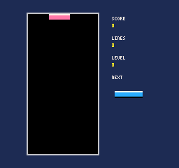
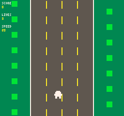
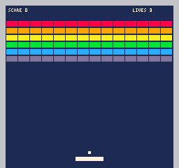
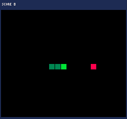
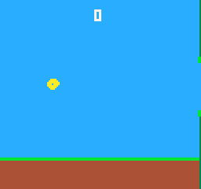
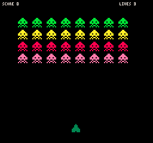
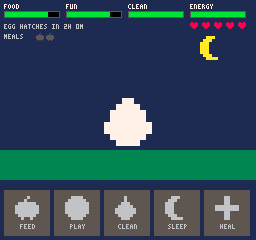

# QRG – QR Game Engine

**A whole game inside one QR code.** Scan it with any phone camera and it opens in the browser as a retro console
game. No app, no account, no server-side storage: the game *is* the QR code.

```
https://your.host/path/#<compressed game>        ← the text inside the QR code
```

The page at that address is one self-contained file, `index.php`. It reads the game from the URL fragment (which never
leaves the device), decompresses it and runs it on a 256 × 240 pixel console with an on-screen pad, touch gestures and keyboard.

* **Any game** – the engine has no genres or templates, only drawing, sound, input, storage and a small standard library.
  Tetris, a racing game, a turn-based strategy game and a pocket pet that lives in real time are all just programs ([`games/`](games/)).
* **Tiny** – a custom compressor tuned for game code. Typical games are QR version 10–17; the two big demos (a tactics game and a
  pet) are about v30. Limit: about 2.9 KB of compressed code. Sizes: [docs/GAMES.md](docs/GAMES.md).
* **Two ways to make games** – a code editor (live preview, suggestions, tap a sprite / color / sound in the code to edit it
  graphically) and a **visual editor** where you draw sprites, place them with Select / Place / Delete tools and describe
  behavior with WHEN / IF / DO rules; the program is written for you.
* **Memory per game** – `save()` / `load()` keep data on the device, private to that one game, so a game can go on while it is
  closed (the pet needs feeding twice a day).
* **A forever player** – the Reader scans any QRG code, whatever the link around it looks like.
* **Safe to open** – every game runs in a sandboxed iframe with no network and no access to the page. See [Security](#security).
* **PWA** – installable; after the first visit it opens instantly from the device (cache first) and updates itself in the background. MIT licensed.

## Gallery

Real recordings of the demo games running on the engine (scripted player, 256 × 240, 16 colors). Each one is a single QR code.

| | | |
|---|---|---|
| <br>**Tetris** | <br>**Racing** | <br>**Breakout** |
| <br>**Snake** | <br>**Flappy** | <br>**Invaders** |
| <br>**Tiny Pet** – a pet that lives in real time (hours sped up here) | | |

Regenerate them with `npm run gifs`.

## Two files

| File | What it is |
|---|---|
| `index.php` | **The player.** One small file (~48 KB, everything inline). Opens a game from the URL, or shows a short intro. The only PHP: it shows a link to `e.html` when that file exists next to it. |
| `e.html` | **The extras.** Library of demo games, code editor, visual editor, reader (QR scanner). Optional: if you do not upload it, the player works alone. |

Plus the PWA files `manifest.webmanifest`, `sw.js`, `icon-*.png` (a service worker and a manifest cannot be inlined) and
`vendor/jsQR.js` (a QR scanner for browsers that lack `BarcodeDetector`; only loaded when needed, Apache-2.0).

## Quick start

1. Run `npm install && npm run build`, then upload the **contents of `dist/`** to your server (HTTPS; PHP only for `index.php`).
2. Set `BASE` in [`src/app/config.js`](src/app/config.js) to the URL where you host it (it must end with `#`) *before* building,
   so the QR codes point to your server.
3. Open it, tap a demo (e.g. *Tetris*): a QR code appears. Scan it with another phone: the game opens.
4. Open `e.html` for the editors and the reader.

Without PHP (static hosting) rename `index.php` to `index.html` and delete the three PHP lines; the link to the extras is then
always shown. Opening the files straight from disk works for playing and editing; the camera needs HTTPS.

## Writing a game

A game is the body of a JavaScript function that returns a per-frame function. The code editor starts with a small, fully
commented example, and every demo game opens with explanatory comments (comments cost nothing in the QR code: they are removed
before a game is packed).

```js
let x = 120, y = 110, score = 0;

return i => {                              // called 60 times per second
  cls(NAVY);
  if (i.l) x -= 2;                         // d-pad / arrow key / swipe left
  if (i.t) { x = i.x - 8; y = i.y - 8; }   // finger on the screen
  if (i.A) { score++; s(600); }            // A button / tap
  r(x, y, 16, 16, ORANGE);
  t('SCORE ' + score, 4, 4, WHITE);
};
```

The standard library has drawing, text, sprites, input helpers, random numbers, moving objects ("actors"), grids and path
finding, sound and per-game memory. Everything is documented in **[docs/LANGUAGE.md](docs/LANGUAGE.md)** (also inside the app);
the visual editor in **[docs/VISUAL.md](docs/VISUAL.md)**.

## How it fits in a QR code

1. **Minify** – comments and spaces removed by a scanner that understands strings, templates and regular expressions
   (`src/codec/minify.js`; tests prove the program still does exactly the same).
2. **Compress** – a context-mixing compressor (`src/codec/cm.js`, integer math only so every browser decodes identically),
   primed with a dictionary of typical code (`src/codec/prime.js`). The dictionary is **not** built from the demo games, so the
   sizes in [docs/GAMES.md](docs/GAMES.md) are what a brand-new game costs.
3. **Encode** – bytes → base-43 (`0-9 A-Z $ * + - . / :`: URL-safe and inside the QR alphanumeric set, 5.5 bits per character).
4. **QR** – `https://host/path/#` as a byte segment plus the payload as an alphanumeric segment, error correction level L
   (`src/qr/qr.js`, versions 1–40, verified against an independent decoder for every size class).

## Repository layout

```
dist/                 what you upload (generated by `npm run build`)
  index.php  e.html  manifest.webmanifest  sw.js  icon-192.png  icon-512.png  vendor/
src/
  app/                config, runner (sandboxed iframe + per-game memory), shell, reader, UI helpers
  codec/              minifier, compressor, base-43, payload format
  qr/                 QR code encoder
  engine/             standard library, sprites, runtime (input, loop), game document builder, library docs
  editor/             code editor + code assistant, visual editor (UI + compiler + starter projects)
  lite/               the player page (template.php + lite.js)
  pwa/                service worker template
  retro.css  full.css  lite.css  template.html
games/                the demo games: one file each, "// @name" header + the commented game source
tests/                tests (node --test) and tests/programs/ (QRG programs used to test the engine)
tools/                build.js (bundles everything), docs.js (generates docs/), icons.js, manifest.js (file order)
docs/                 generated reference: LANGUAGE.md, VISUAL.md, GAMES.md; img/ gameplay GIFs (npm run gifs)
```

The engine, the demo games and the test programs are separate: nothing in `src/` knows about any particular game.

## Development

```bash
npm install        # only dependency: jsqr, used by the tests to decode generated QR codes
npm run build      # dist/ + docs/
npm run gifs      # re-record docs/img/*.gif (gameplay recordings for this README)
npm test           # about 240 tests: library, runtime, compiler, codec, QR, games, security, PWA, docs, build
```

Add a game by dropping a file into `games/` (e.g. `13-mygame.js`) with a header:

```js
// @name My game
// @color #ff77a8
// @about One line for the home screen.
let x = 0;
return i => { ... };
```

then `npm run build`. Tests fuzz every game automatically.

## Compatibility note

The compressor, its dictionary, the base-43 alphabet and the standard library define the wire format. Changing any of them
makes QR codes made earlier decode to something else (or fail). The test `wire format is frozen` fails when that happens;
update its expected value only on purpose, and host the new build under a new URL (e.g. `/v2/`) so old QR codes keep
working against the old build. Per-game memory is keyed by a fingerprint of the *minified* code: editing a game starts it
with an empty memory, adding comments does not.

## Security

A QR code can carry any program, so **every game is untrusted code**:

* it runs in an `<iframe sandbox="allow-scripts">` (no same-origin access: no cookies, no storage, no access to the page, no
  popups, no navigation);
* the iframe document has a Content-Security-Policy with `default-src 'none'`, which blocks every network request
  (including images and forms), so a game cannot send anything anywhere;
* `save()` / `load()` do not touch the sandbox: the page stores the data on behalf of the game, under a key derived from the
  game's code, with size and count limits, after validating every message;
* if a browser refuses to start sandboxed frames, the page says so and offers an explicit *Run without protection* button;
* untrusted data (project JSON, scanned text, URL fragments, saved values) is validated and size-limited before use.

`tests/programs/sandbox-probe.js` is a self-test you can run yourself: it reports whether a game can reach cookies, storage, the parent
page, other windows, popups or the network. It only tests whether an access is *possible*; it reads nothing and sends nothing. In
normal play every line must say BLOCKED. Serving the page from its own (sub)domain is still wise, so that nothing else lives on the origin.

## Contributing

Issues and pull requests are welcome. Please run `npm run build && npm test` before sending a change, and keep `src/` free of
anything game-specific. New library functions need an entry in `src/engine/libdoc.js` (a test enforces it).

## License

MIT – see [LICENSE](LICENSE). The bundled QR scanner `vendor/jsQR.js` is Apache-2.0 (license file included).
